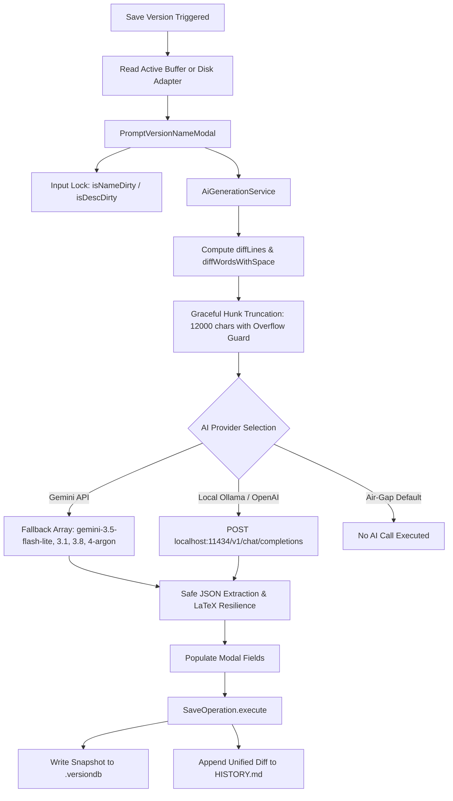

# Implementation Plan: Version Control v2.0.1-beta Hardening & Documentation

## 1. Architectural Overview & Context
This release hardens the v2.0.1-beta implementation of **Version Control for Obsidian**, an air-gapped, per-note version control and milestone tracking system. 



## 2. Component Enhancements (With Approved Refinements)

### A. Surgical Diff Truncation & Hunk Overflow Guard
- File: [`src/services/ai-generation-service.ts`](src/services/ai-generation-service.ts:110)
- **Refinement**:
  - Accumulate discrete change hunks until adding another hunk exceeds `MAX_DIFF_CHARS`.
  - **Single-Hunk Overflow Guard**: If a single hunk by itself exceeds the remaining budget (e.g. `hunks.length === 0` on an oversized paste), slice that hunk to fit the remaining budget, close any dangling `{+` or `[-` delimiters cleanly, and append the truncation banner `\n\n[... Diff truncated: Remaining change hunks omitted to fit context window ...]`.
  - Never return an empty payload when modifications exist.

### B. Fallback Model Alignment
- File: [`src/services/ai-generation-service.ts`](src/services/ai-generation-service.ts:231)
- **Refinement**:
  - Update `fallbackModels` to:
    `['gemini-3.5-flash-lite', 'gemini-3.1-flash-lite', 'gemini-3.8-flash', 'gemini-4-argon']`

### C. Safe JSON Extraction & Non-Standard Model Resilience
- File: [`src/services/ai-generation-service.ts`](src/services/ai-generation-service.ts:277)
- **Refinement**:
  - Strip markdown code fences (`` ```json ... ``` ``).
  - Attempt standard `JSON.parse` first.
  - If direct parse fails, locate the outer-most balanced or matched `{ ... }` bounds to prevent failure when Markdown diff payloads contain LaTeX, curly bracket syntax, or conversational prefix/suffix text.
  - Wrap in a safe `try/catch` fallback returning `{ name: 'Updated note', description: '- Version updated.' }` without throwing unhandled UI errors.

### D. README Modernization & Asset Conversion
- File: [`README.md`](README.md:1)
- **Refinement**:
  - Replace remote GitHub-hosted image links (`Lae-Aragi/Version-Control` and `Yuichi-Aragi/Version-Control`) with local repository paths (`assets/1000202057.jpg`, etc.).
  - Purge broken `shields.io` badges, upstream archived notices, and no-PR statements.
  - Document Dean Innovative Design maintainership (Elijah Dean) and community contribution guidelines.
  - Update Download and Installation documentation for `endean-eng/Obsidian-Version-Control-Local` (Stable releases via GitHub Releases and Beta pre-releases via Obsidian BRAT plugin).

### E. Roadmap Creation
- File: [`ROADMAP.md`](ROADMAP.md:1)
- **Refinement**:
  - Document v2.0.1-beta.1 capabilities.
  - Under **v2.0.2**: Include bidirectional synchronization of `.versiondb/<noteId>/HISTORY.md` when users retroactively edit version names/descriptions or delete versions from the sidebar, along with offline Ollama automated benchmarking.
  - Document future milestones (v2.1.0 selective cherry-picking, v2.2.0 canvas/base support).

## 3. Execution Tasks
- [ ] Implement refinements in [`src/services/ai-generation-service.ts`](src/services/ai-generation-service.ts:1)
- [ ] Revise [`README.md`](README.md:1) with local assets and Dean Innovative Design installation
- [ ] Create [`ROADMAP.md`](ROADMAP.md:1) with synchronization items
- [ ] Execute `npx pnpm run build` in Code mode
